# Габриелян Григорий ЛА-4 Лабораторная №3

# Задание 1

## Задача 3

### Текст задачи

Первый массив, размерностью n × m, заполняется данными, вводимыми с клавиатуры, так что заполнение ведётся по столбцам от первых элементов столбца к последним.

Второй массив, размерностью n × n, заполняется так: элементы, лежащие выше побочной диагонали, являются случайными числами из интервала [-12; 4565], а лежащие на побочной диагонали и ниже, являются случайными числами из интервала [-1024; 1024].

Третий массив, размерностью n × n, заполняется для произвольного n так же, как для n = 5:

```text
 0  0  0  0 15
 0  0  0 14 10
 0  0 13  9  6
 0 12  8  5  3
11  7  4  2  1
```

### Алгоритм решения

1. Создать класс `Matrix` в отдельном файле. Единственное поле класса — двумерный массив `_values`. Задания 1–3 выполняются методами этого класса.
2. В первом конструкторе ввести элементы с клавиатуры: внешний цикл перебирает столбцы, внутренний — строки сверху вниз.
3. Во втором конструкторе проверить условие `row + column < size - 1`. Если оно выполнено, выбрать случайное целое из [-12; 4565], иначе — из [-1024; 1024]. Верхние границы включаются.
4. В третьем конструкторе оставить нули выше побочной диагонали. Начать с единицы в правом нижнем углу. Перебирать диагонали с постоянной суммой индексов от `2 * size - 2` до `size - 1`. Внутри каждой диагонали двигаться от нижней строки к верхней, увеличивая число на единицу.
5. Переопределить `ToString()`: циклом сформировать таблицу с помощью `StringBuilder`.
6. Ввести размеры с клавиатуры. Разрешить размеры от 1 до 100; неверный ввод запрашивать повторно. Все элементы вводятся как `int`, а хранятся как `long`, чтобы суммы и результат выражения из задания 3 не переполнялись при допустимом вводе.

### Тестирование

Первый массив 2 × 2 вводится по столбцам. Третий массив при n = 5 совпадает с образцом. У второго массива проверены обе области и допустимые диапазоны случайных чисел.

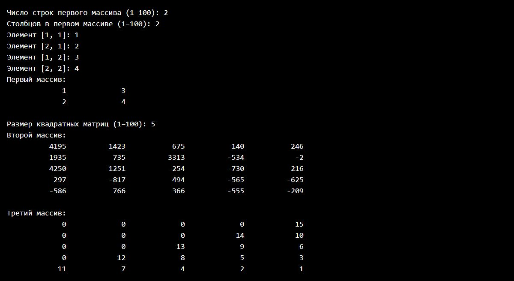

Отклоняются текст, нулевые и отрицательные размеры и число за пределами `int`. После повторного ввода создаются матрицы размера 1 × 1; третий массив содержит единицу.

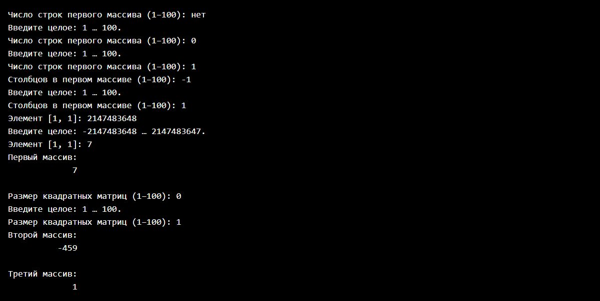

Скриншоты программы показывают ввод и результат выполнения каждого задания белым моноширинным текстом на чёрном фоне, без меню выбора и внешних заголовков. Полные протоколы реальных запусков находятся в каталоге `tests`.

# Задание 2

## Задача 3

### Текст задачи

Задан двумерный массив n × m. Найдите в нём подмассив 3 × 3, сумма элементов которого максимальна. N и m могут быть не кратны трём.

### Алгоритм решения

1. Ввести n и m от 3 до 100, затем элементы массива. Для ввода использовать конструктор `Matrix` из задания 1.
2. Методом `FindMaximumSubmatrix()` перебрать все возможные позиции левого верхнего угла подмассива: строки от 0 до `Rows - 3` и столбцы от 0 до `Columns - 3` включительно.
3. Для каждой позиции двумя короткими циклами сложить девять элементов. Подмассивы могут перекрываться.
4. Сравнить сумму с максимальной. Начальное значение — `long.MinValue`, поэтому корректно обрабатываются и полностью отрицательные массивы.
5. Запомнить позицию максимума, скопировать найденный подмассив и вывести его, его сумму и координаты с нумерацией от единицы. При равных суммах оставить первый найденный подмассив.

### Тестирование

Для массива 3 × 4 из чисел от 1 до 12 по строкам найден подмассив с началом [1, 2] и суммой 63. Размер по столбцам не кратен трём.

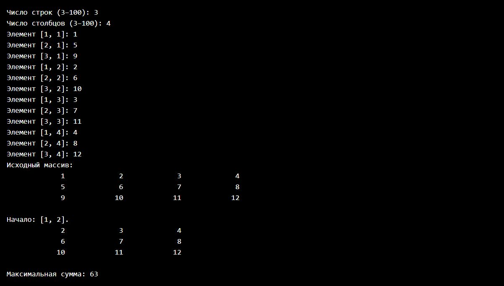

Для массива 3 × 3 из значений -1 получена сумма -9. Размер меньше трёх отклоняется.

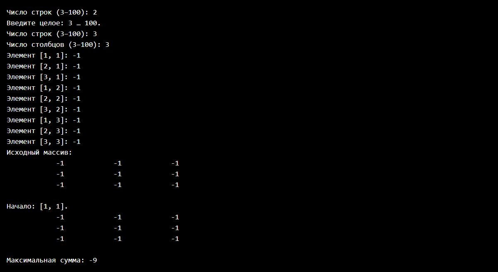

# Задание 3

## Задача 3

### Текст задачи

Вычислить матричное выражение Aᵀ + 2 * B + Cᵀ.

Перегрузить необходимые операторы и посчитать значение матричного выражения. Решение без перегрузки не принимается. Перегрузить метод `ToString()` — сформировать строку из двумерного массива для отображения его на экране в виде таблицы. Приложить в отчёт скриншот проверки на онлайн-калькуляторе, чтобы показать, что выражение посчитано верно.

### Алгоритм решения

1. Ввести число строк и столбцов результата. Для совместимости размеров создать B с размером `rows × columns`, а A и C — с размером `columns × rows`. Ввести элементы всех трёх матриц с клавиатуры по столбцам.
2. В классе `Matrix` перегрузить унарный оператор `~`: транспонировать матрицу, поменяв индексы строки и столбца местами.
3. Перегрузить оператор `*` для умножения целого числа на матрицу: умножить каждый элемент на число.
4. Перегрузить оператор `+`: проверить совпадение размеров и сложить соответствующие элементы.
5. Вычислить результат непосредственно выражением `~first + 2 * second + ~third`. Каждый оператор возвращает новую матрицу.
6. Вывести исходные матрицы и результат через `ToString()`.

### Тестирование

Для A = [[1, 2], [3, 4]], B = [[5, 6], [7, 8]], C = [[9, 10], [11, 12]] получено [[20, 26], [26, 32]].

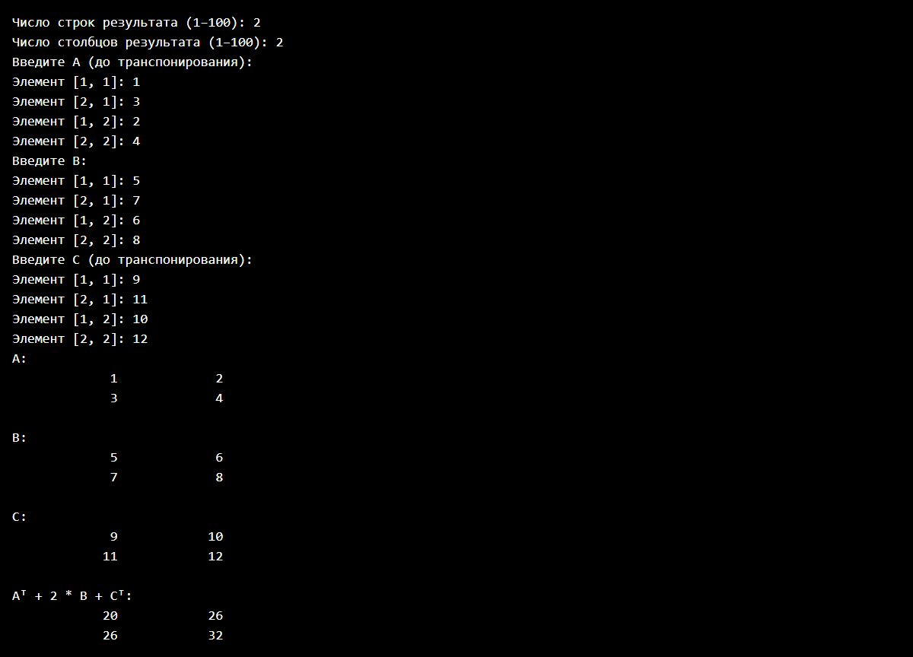

Проверка того же выражения в [онлайн-калькуляторе Matrixcalc](https://matrixcalc.org/ru/#%7B%7B1,2%7D,%7B3,4%7D%7D%5ET+2*%7B%7B5,6%7D,%7B7,8%7D%7D+%7B%7B9,10%7D,%7B11,12%7D%7D%5ET) дала тот же результат.

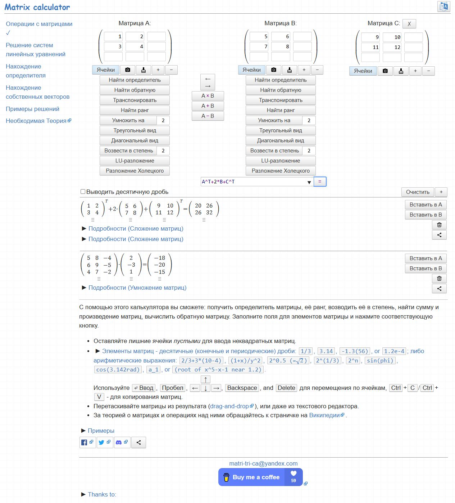

Для A = [[1], [2]], B = [[3, 4]], C = [[-1], [-2]] получена матрица [[6, 8]]. Проверена работа с неквадратными матрицами.

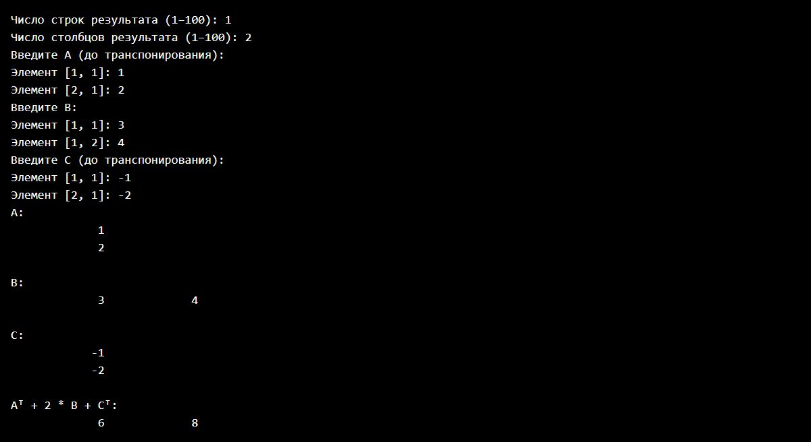

# Задание 4

## Задача 3

### Текст задачи

Получить в новом файле все компоненты исходного файла, которые делятся на m и не делятся на n.

Бинарные файлы содержат числовые данные. Исходный файл необходимо заполнить случайными данными, заполнение организовать отдельным методом.

### Алгоритм решения

1. Задания 4–8 реализовать статическими методами одного класса `FileTasks` в отдельном файле.
2. Ввести количество чисел, границы случайного заполнения и делители m, n. Проверить целочисленный ввод, порядок границ и отсутствие нулевых делителей.
3. Отдельным методом `FillBinaryFile()` создать `data/numbers.bin`. Записать случайные целые числа через `BinaryWriter`; диапазон включает обе границы. Каждое число хранится как `Int32`.
4. Методом `FilterBinaryFile()` последовательно прочитать исходный файл через `BinaryReader`.
5. Если остаток от деления числа на m равен нулю, а остаток от деления на n не равен нулю, записать число в `data/filtered.bin`. Порядок и повторения сохранить.
6. Перед вычислением остатка преобразовать число к `long`, чтобы безопасно обработать `int.MinValue` и делитель -1.
7. Вывести исходные и отобранные числа. При отсутствии совпадений создать пустой результат и вывести соответствующее сообщение.

### Тестирование

Созданы 20 случайных чисел из [-10; 10]. В новый бинарный файл попали ровно числа, делящиеся на 2 и не делящиеся на 3. Содержимое файлов дополнительно проверено чтением двоичных чисел.

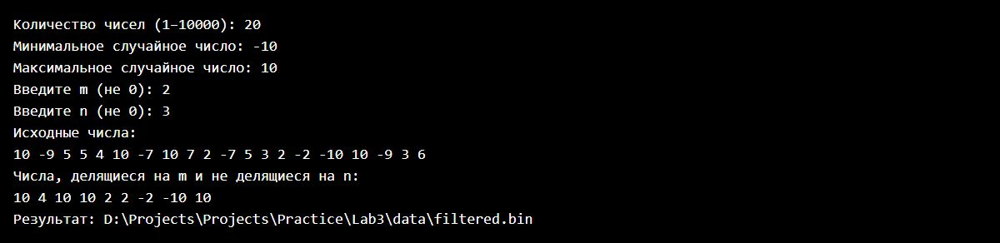

Если все исходные числа равны 6, m = 2 и n = 3, новый файл пуст. Нулевой и нечисловой делители отклоняются.

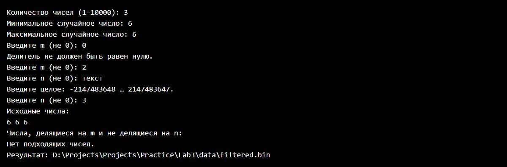

# Задание 5

## Задача 3

### Текст задачи

Информация о багаже пассажира описывается массивом, где каждый элемент содержит название единицы багажа (чемодан, сумка, коробка и т. д.) и её массу. Дан файл, содержащий сведения о багаже нескольких пассажиров. Выяснить, имеется ли пассажир, багаж которого состоит из одной единицы багажа массой менее m кг.

Бинарные файлы содержат величины типа `struct`. Заполнение исходного файла необходимо организовать отдельным методом. Обязательно использовать XML-сериализацию; решение без сериализации не принимается.

### Алгоритм решения

1. Создать структуры `BaggageItem` и `Passenger` в отдельных файлах. Первая хранит название и массу, вторая — массив единиц багажа. Для XML-сериализации структуры и их обычные свойства доступны публично; автосвойства не используются.
2. В отдельном методе `FillBaggageFile()` ввести количество пассажиров, затем количество мест багажа, названия и массы. Разрешить отсутствие багажа. Отклонять пустые названия и неположительную или нечисловую массу. Дробная масса допускает точку и запятую.
3. Сериализовать массив структур `Passenger[]` с помощью `XmlSerializer` в строку XML. Записать её в бинарный файл `data/baggage.bin` методом `BinaryWriter.Write(string)`: длина строки и её байты в UTF-8. Таким образом, используется бинарный контейнер для обязательной XML-сериализации.
4. Прочитать строку через `BinaryReader.ReadString()` и восстановить массив структур через `XmlSerializer.Deserialize()`.
5. Ввести положительное значение m. Перебрать пассажиров и проверить два условия: количество мест равно единице и масса единственного места строго меньше m.
6. Вывести номера подходящих пассажиров и сообщение о наличии либо отсутствии результата.

### Тестирование

У первого пассажира одна сумка массой 2,5 кг, у второго — два места. При m = 3 подходит только первый пассажир. Проверено восстановление структур из бинарного файла после XML-сериализации.

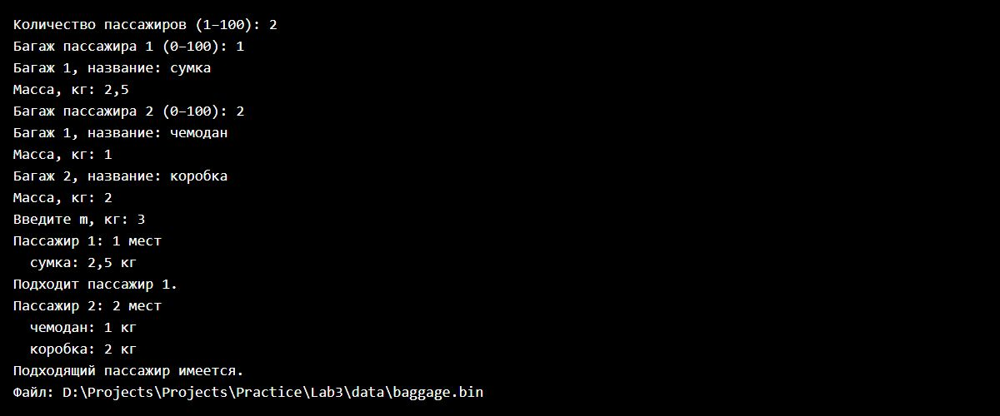

Масса единственного места равна 3 кг при m = 3: пассажир не подходит, поскольку требуется строгое неравенство. Пассажир без багажа также не подходит. Пустое название, отрицательная и нечисловая масса отклоняются.

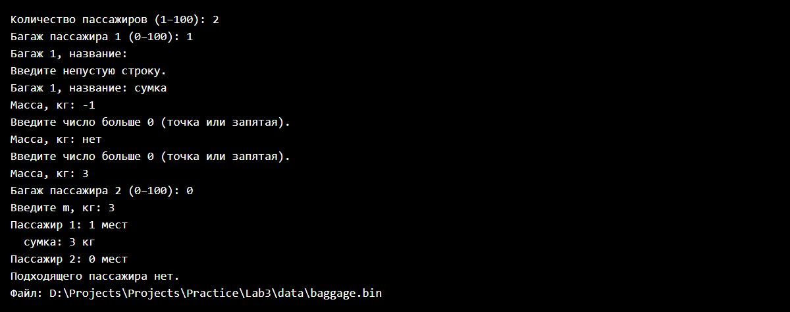

# Задание 6

## Задача 3

### Текст задачи

Найти разность максимального и минимального элементов.

В текстовом файле хранятся целые числа по одному в строке. Исходный файл необходимо заполнить случайными данными, заполнение организовать отдельным методом.

### Алгоритм решения

1. Ввести количество чисел и границы случайного заполнения. Отклонять неположительное количество, нецелые значения и верхнюю границу меньше нижней.
2. Отдельным методом `FillTextFile()` создать `data/one-per-line.txt`, записав каждое случайное целое число в отдельную строку.
3. В методе `FindDifference()` прочитать первое число и принять его за начальные минимум и максимум.
4. Прочитать остальные числа. Если очередное число меньше минимума или больше максимума, обновить соответствующее значение.
5. Вернуть разность `(long)maximum - minimum`. Преобразование к `long` позволяет получить разность даже между `int.MaxValue` и `int.MinValue`.
6. Вывести содержимое файла и результат. Для пустого файла предусмотрено исключение с сообщением об отсутствии чисел; обычное заполнение создаёт не меньше одного числа.

### Тестирование

Для восьми случайных чисел из [-20; 20] результат сопоставлен с максимумом и минимумом фактически созданного файла.

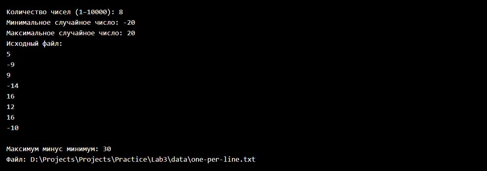

Файл с единственным числом 5 даёт разность 0. Отклоняются нулевое количество и верхняя граница меньше нижней.

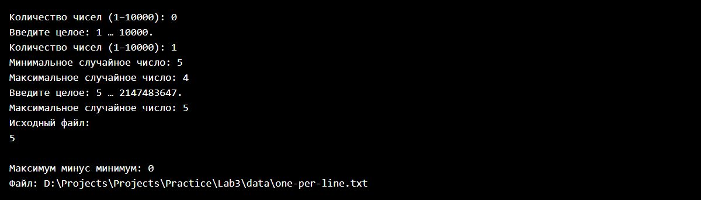

# Задание 7

## Задача 3

### Текст задачи

Вычислить минимальный элемент.

В текстовом файле хранятся целые числа по несколько в строке. Исходный файл необходимо заполнить случайными данными, заполнение организовать отдельным методом.

### Алгоритм решения

1. Ввести количество чисел, границы случайного заполнения и количество чисел в строке от 2 до 100.
2. Методом `FillTextFile()` создать `data/several-per-line.txt`: записывать числа через пробел, после нужного количества чисел переходить на новую строку. Последняя строка может быть неполной.
3. Методом `FindMinimum()` читать файл построчно. Разбить каждую строку по пробельным символам с удалением пустых частей.
4. Преобразовать каждую часть в целое число и обычным циклом найти минимум. Начальное значение минимума — `int.MaxValue`; отдельным флагом проверить наличие хотя бы одного числа.
5. Вывести исходный файл и минимум. Для пустого файла предусмотрено сообщение через исключение.

### Тестирование

Созданы десять случайных чисел по три в строке. Минимум сравнивается со всеми числами фактически созданного файла, включая последнюю неполную строку.

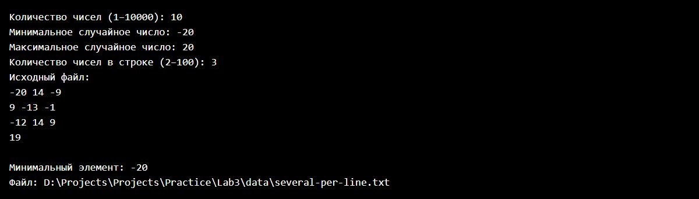

Пять одинаковых отрицательных чисел -7 записаны по два в строке; последняя строка содержит одно число. Минимум равен -7. Значение 1 для количества чисел в строке отклоняется.

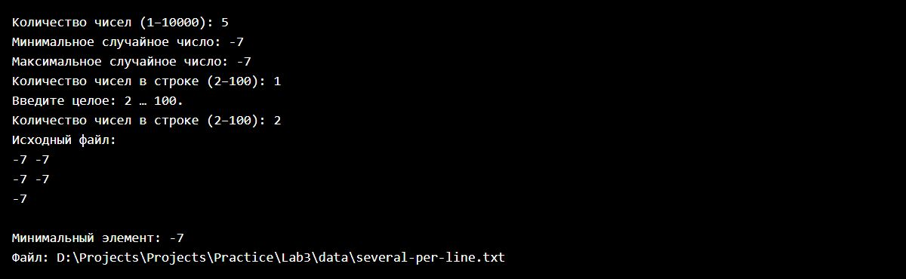

# Задание 8

## Задача 3

### Текст задачи

Переписать в другой файл строки, начинающиеся с заданного символа.

В текстовом файле хранится текст.

### Алгоритм решения

1. Ввести количество строк и сами строки, включая пустые. Записать их в текстовый файл `data/source-lines.txt`.
2. Ввести ровно один символ. Пустой ввод и строку из нескольких символов запросить повторно. Пробел также может быть искомым символом.
3. Методом `FilterLines()` читать исходный файл построчно.
4. Проверить, что строка не пустая и её первый символ равен заданному. Регистр учитывать, начальные пробелы не удалять.
5. Подходящую строку целиком записать в `data/filtered-lines.txt`. Сохранить порядок строк.
6. Вывести количество скопированных строк и содержимое нового файла. Если совпадений нет, результатом будет пустой файл.

### Тестирование

При поиске символа «А» скопированы «Арбуз» и «Аист». Пустая строка, «абрикос» с маленькой буквы и строка с начальным пробелом не скопированы.

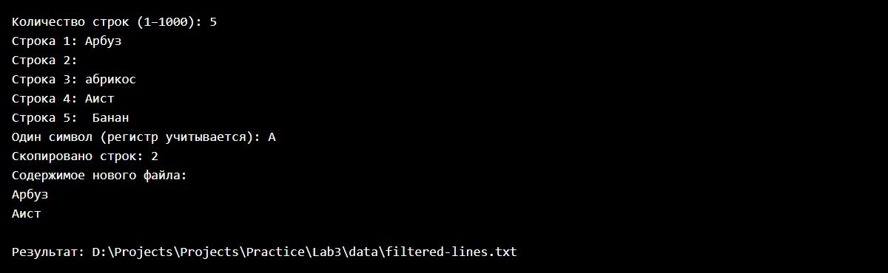

При поиске символа «Я» среди строк «Кот» и «Дом» совпадений нет: создан пустой файл. Пустой искомый символ и два символа отклоняются.

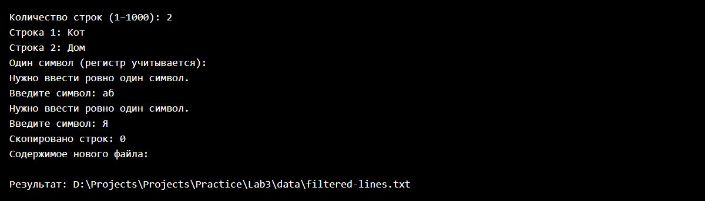
